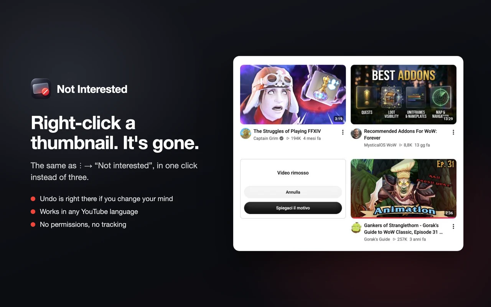

# Not Interested


Not Interested clears videos from your YouTube recommendations with a single
right-click. Right-click a thumbnail and the video is marked **Not interested**,
the same as opening its ⋮ menu and choosing "Not interested" yourself.



| You do | What happens |
| --- | --- |
| **Right-click a thumbnail** | YouTube replaces the card with its own **Video removed · Undo · Tell us why** panel. |
| **Click Undo** | The video comes back, as with YouTube's own menu. |
| **Shift + right-click** (or Alt/Cmd) | The browser's context menu opens as usual. |
| **Right-click a title or channel name** | The browser's context menu opens: only thumbnails are taken over. |

While it works, the thumbnail dims and YouTube's menu stays invisible, so the
menu doesn't flash open. If a video has no "Not interested" entry (YouTube
leaves it out of search results, for example), a short note appears in the
bottom-left corner and nothing is clicked. The extension works in any YouTube
language; the screenshots show YouTube in Italian.

<details>
<summary>More screenshots</summary>


</details>

## Download a release

Get the [latest release](https://github.com/icoretech/youtube-not-interested/releases/latest).
Each release includes standalone downloads:

- **[Unsigned Firefox ZIP](https://github.com/icoretech/youtube-not-interested/releases/latest/download/youtube-not-interested-firefox-unsigned.zip)**
  — in a LibreWolf profile that accepts unsigned add-ons
  (`xpinstall.signatures.required` set to `false` in `about:config`), open
  `about:addons`, click the gear, choose **Install Add-on From File**, and
  select the downloaded ZIP directly. It stays installed after a restart.
  Standard Firefox requires the Mozilla-signed
  `youtube-not-interested-firefox.xpi`, attached to a release once Mozilla
  approves it. To test the unsigned ZIP there, open
  `about:debugging#/runtime/this-firefox` and select the ZIP with
  **Load Temporary Add-on**.
- **[Chrome ZIP](https://github.com/icoretech/youtube-not-interested/releases/latest/download/youtube-not-interested-chrome.zip)**
  — extract the archive to a folder you will keep. In Chrome's extensions page,
  enable **Developer mode**, choose **Load unpacked**, and select that folder.
- **[Reviewer source](https://github.com/icoretech/youtube-not-interested/releases/latest/download/youtube-not-interested-review-source.zip)**
  — rebuild the extension with the instructions below. To verify the downloads,
  put all three ZIPs and the release's `SHA256SUMS` in the same directory and
  run `shasum -a 256 -c SHA256SUMS`.

## Install from source

From the repository root, use Node.js 24 or newer and npm:

```sh
npm ci
npm run build
```

1. Open `about:debugging#/runtime/this-firefox`.
2. Click **Load Temporary Add-on…** and select `dist/firefox/manifest.json`.
3. Open or reload a youtube.com tab and right-click a thumbnail.

A temporary add-on stays loaded until the browser restarts. After rebuilding,
click **Reload** next to it on the same page.

To keep it installed across restarts, package it and install the ZIP:

```sh
npm run package
```

In a LibreWolf profile that accepts unsigned add-ons
(`xpinstall.signatures.required` set to `false` in `about:config`), open
`about:addons`, click the gear, choose **Install Add-on From File**, and select
the ZIP in `artifacts/firefox/`. It stays installed after a restart. To update,
build and install again the same way. Standard Firefox keeps only
Mozilla-signed add-ons installed, so use the temporary installation there.

**Chrome, Brave, Edge, or Arc:** open the browser's extensions page, enable
**Developer mode**, choose **Load unpacked**, and select `dist/chrome/`. Only the
Firefox build is tested on live YouTube.

## How it works

On a right-click over a thumbnail, the extension opens that video's ⋮ menu,
finds the "Not interested" entry, and clicks it. YouTube then handles the
dismissal exactly as if you had clicked the entry yourself.

The entry is found without relying on the UI language: first by its icon
(a circle with a slash), then by the data of YouTube's older menus, then by its
exact label in about twenty languages, and finally by its position directly
above "Don't recommend channel" and "Report". When none of these is certain,
the extension clicks nothing.

The extension runs one content script on `https://www.youtube.com/*`. It has no
permissions, no background script, and no storage, and it makes no network
requests of its own.

## Development

```sh
npm test
npm run biome:ci
npm run package
npm run web-ext:lint
```

`npm run biome:ci` checks formatting, lint, and TypeScript. `npm run package`
builds both browsers and writes their ZIPs to `artifacts/chrome/` and
`artifacts/firefox/`. `scripts/make-icons.sh` rebuilds the icons from
`assets/brand/logo-source.png` (requires ImageMagick 7).

If YouTube changes its markup, start with the
[card and thumbnail selectors](src/youtube/selectors.ts),
[thumbnail hit-testing](src/youtube/card.ts),
[menu matching](src/youtube/menu.ts), or the
[menu automation](src/youtube/not-interested.ts).
[`install.ts`](src/content/install.ts) handles the `contextmenu` event, the busy
state, and the failure note.

### Checking against live YouTube

The debug build reports what the extension finds on each right-click:

```sh
npm run build:debug
node scripts/debug-server.mjs
```

Load (or **Reload**) `dist/firefox/manifest.json` as above and right-click a
thumbnail. The collector prints each right-click and appends it to
`debug-reports.ndjson` (git-ignored). Each record holds the card markup, the
⋮ button used, every menu entry with its label and icon path, and how
"Not interested" was matched. New icon paths go in
[`menu.ts`](src/youtube/menu.ts). Run `npm run build` again before regular use:
production builds contain no debug code.

## Releases

CI runs on pull requests and pushes to `main` using GitHub-hosted Linux runners.
Merging the release-please version PR creates a version tag and a draft
release. The release workflow checks out that tag, runs the tests, builds and
validates the packages, and publishes the draft with its downloads. To retry
an interrupted draft, run the **Release** workflow on `main` with its tag.
Dependency updates alone don't start a release: they ship with the next
feature or fix.

After publishing, the release workflow runs **Submit to stores**, which sends
the published packages to the Chrome Web Store and addons.mozilla.org for
review. To retry one store, run **Submit to stores** on `main` with the tag.

### Store submission

Each store job is skipped until its repository settings exist:

| Store | Variables | Secrets |
| --- | --- | --- |
| Chrome Web Store | `GCP_WORKLOAD_IDENTITY_PROVIDER`, `CWS_SERVICE_ACCOUNT` | none |
| addons.mozilla.org | `AMO_SUBMIT` set to `true` | `AMO_API_KEY`, `AMO_API_SECRET` |

The Chrome job signs in with GitHub's OIDC token through Workload Identity
Federation, so no Google key is stored. The service account must be the one
added under **Account** in the Chrome Web Store dashboard. The Firefox job uses
the AMO API credentials, takes the license and reviewer notes from
`store/amo-metadata.json`, uses the GitHub release notes as the version notes,
and uploads the release's source archive. Listing text and images are edited in
each store's dashboard.

To check the credentials without uploading anything, run **Check store access**
on `main`. It reads the Chrome Web Store item status and the AMO account.

After Mozilla approves a listed version, run **Attach signed Firefox XPI**
on `main` with the same tag. It verifies Mozilla's SHA-256 digest and compares
the extension contents with the published Firefox ZIP before attaching the XPI.

## Build for AMO reviewers

From the source archive root, run `npm ci` followed by `npm run build` with
Node.js 24 or newer. The lockfile pins the dependencies. Vite produces an
unminified `content.js`, and the build assembles the Firefox manifest, script,
stylesheet, and icons in `dist/firefox/`. `npm run package:review-source`
creates that archive from this repository.

## License

[MIT](LICENSE). Not Interested is an independent project and is unaffiliated
with YouTube or Google.
